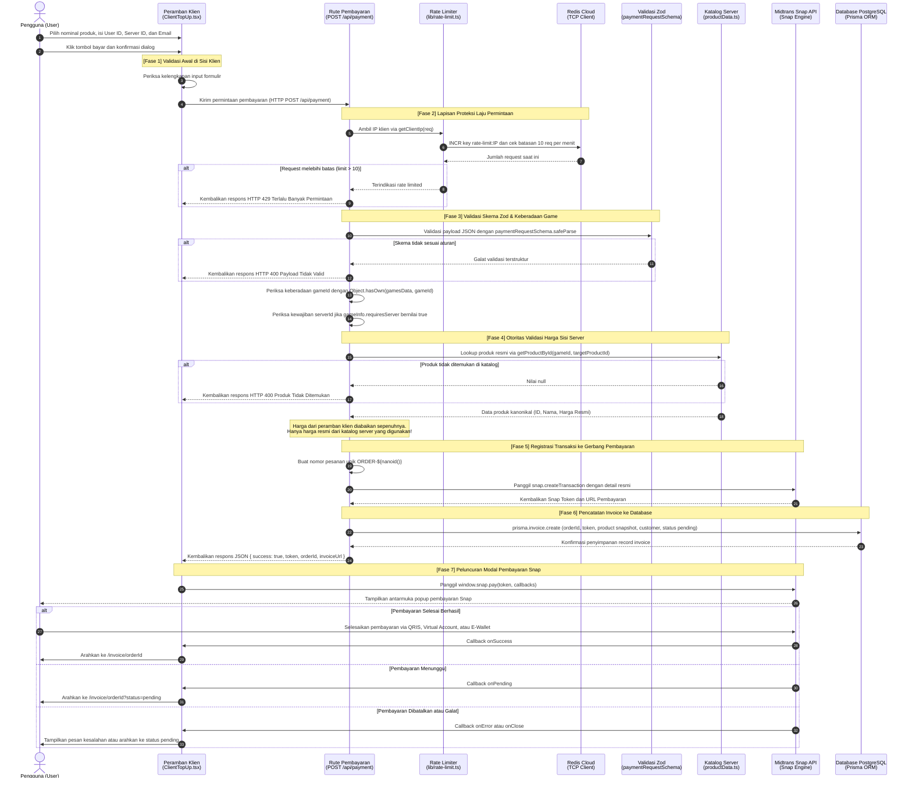

# Alur Checkout dan Validasi Harga Server

Dokumen ini menyajikan alur interaktif proses transaksi checkout pada Kira Topup Store. Alur ini menjamin bahwa setiap transaksi yang dibuat memiliki data yang valid, diverifikasi terhadap katalog resmi di sisi server, dan terlindungi dari manipulasi harga oleh pengguna nakal sebelum pembayaran diluncurkan ke Midtrans Snap.

[Kembali ke Indeks Arsitektur](README.md)

---

## Diagram Urutan Alur Checkout (Sequence Diagram)

Diagram urutan berikut memetakan perjalanan data dari saat pengguna menekan tombol pembayaran pada antarmuka hingga modal pembayaran Midtrans Snap muncul di layar peramban.

---

## Titik Pemeriksaan Keamanan dan Integritas

Alur checkout di atas mengimplementasikan beberapa aturan keamanan utama:

### 1. Otoritas Harga Tunggal di Sisi Server
Klien peramban hanya mengirimkan `productId` dan informasi akun tujuan. Nominal tagihan transaksi (`gross_amount`) ditentukan secara sepihak oleh server menggunakan data master di `lib/datas/productData.ts`. Setiap upaya manipulasi harga pada request HTTP yang dikirim oleh penyerang akan gagal secara otomatis karena server tidak pernah membaca nilai harga yang diajukan oleh klien.

### 2. Perlindungan Prototype Pollution
Pengecekan keberadaan game tujuan menggunakan metode `Object.hasOwn(gamesData, customer.gameId)`. Pendekatan ini mencegah eksploitasi prototype pollution pada objek JavaScript saat memproses input `gameId` yang tidak terdaftar.

### 3. Ekstraksi IP Tepercaya dan Rate Limiting
Sebelum payload diproses, alamat IP klien diambil dengan memprioritaskan header infrastruktur tepercaya (`x-real-ip` dan `cf-connecting-ip`) untuk mencegah pemalsuan header `x-forwarded-for`. Request kemudian dibatasi maksimal 10 permintaan per menit per alamat IP guna menangkis serangan spam transaksi.

### 4. Validasi Masukan Berlapis
Validasi dilakukan pada dua sisi:
- Validasi sisi klien di `ClientTopUp.tsx` untuk kenyamanan interaksi pengguna sebelum tombol submit aktif.
- Validasi sisi server di `app/api/payment/route.ts` menggunakan skema Zod `paymentRequestSchema` untuk menjamin keamanan absolut terhadap request yang dikirim langsung tanpa melalui antarmuka web.

### 5. Pencatatan Snapshot Produk
Data produk yang disimpan ke dalam tabel `Invoice` di database adalah snapshot lengkap dari objek produk kanonikal pada saat transaksi dibuat. Hal ini menjaga riwayat data transaksi masa lalu tetap konsisten meskipun di masa depan terdapat perubahan harga produk pada katalog master.
