# Lapisan Keamanan dan Proteksi Sistem

Dokumen ini memetakan seluruh lapisan pertahanan bertingkat (defense in depth) yang diterapkan pada Kira Topup Store. Arsitektur keamanan ini dirancang untuk melindungi sistem dari berbagai vektor ancaman, termasuk serangan manipulasi harga, injeksi payload, eksploitasi prototype pollution, serangan brute force, timing attack, hingga potensi kebocoran data sensitif.

[Kembali ke Indeks Arsitektur](README.md)

---

## Diagram Alur Lapisan Pertahanan (Flowchart)

Diagram alir berikut memperlihatkan urutan saringan keamanan yang harus dilalui oleh setiap permintaan HTTP sebelum data diperbolehkan mengubah status transaksi di database.

```mermaid
%%{init: {'theme': 'dark', 'themeVariables': {'fontSize': '14px'}}}%%
flowchart TD
    Start(["Permintaan HTTP Masuk ke Endpoint API"]) --> Layer1

    subgraph Lapis1 ["Lapis 1 — Resolusi IP Tepercaya"]
        Layer1{"Cek Header IP\n(lib/rate-limit.ts)"}
        Layer1 -->|"x-real-ip tersedia"| IP_Real["Gunakan x-real-ip\n(Proxy Tepercaya / Vercel)"]
        Layer1 -->|"cf-connecting-ip tersedia"| IP_CF["Gunakan cf-connecting-ip\n(Cloudflare Edge)"]
        Layer1 -->|"Fallback x-forwarded-for"| IP_Forwarded["Ambil entri IP pertama"]
        Layer1 -->|"Tidak ada header"| IP_Unknown["Gunakan label unknown"]

        IP_Real --> ResolvedIP["Alamat IP Klien Terverifikasi"]
        IP_CF --> ResolvedIP
        IP_Forwarded --> ResolvedIP
        IP_Unknown --> ResolvedIP
    end

    ResolvedIP --> Layer2

    subgraph Lapis2 ["Lapis 2 — Sliding Window Rate Limiting"]
        Layer2{"Koneksi Redis Cloud\n(lib/redis.ts)"}
        Layer2 -->|"Redis Tersedia"| Redis_Incr["INCR rate-limit:IP\nPasang EXPIRE 60s pada hit pertama"]
        Redis_Incr --> CheckLimit{"Hitungan > 10 req/menit?"}
        CheckLimit -->|"Ya — Batas Terlampaui"| Resp429["Tolak Permintaan\nHTTP 429 Terlalu Banyak Permintaan"]
        CheckLimit -->|"Tidak — Dalam Batas"| PassRateLimit["Lolos Saringan Rate Limit"]

        Layer2 -->|"Redis Gagal / Offline"| FailOpen["Mekanisme Fail Open\nCatat log peringatan, loloskan request"]
        FailOpen --> PassRateLimit
    end

    PassRateLimit --> Layer3

    subgraph Lapis3 ["Lapis 3 — Validasi Masukan Ketat (Zod)"]
        Layer3{"Validasi Zod Schema\n(lib/validations/payment.ts)"}
        Layer3 -->|"Payload Rusak / Tidak Valid"| Resp400["Tolak Permintaan\nHTTP 400 Format Galat Terstruktur"]
        Layer3 -->|"Struktur Data Lolos"| PassZod["Data Masukan Terverifikasi"]
    end

    PassZod --> Layer4

    subgraph Lapis4 ["Lapis 4 — Logika Bisnis & Anti Manipulasi Harga"]
        Layer4{"Cek Prototype & Katalog Server"}
        Layer4 -->|"Object.hasOwn(gamesData, gameId)"| CheckGame{"Game Terdaftar?"}
        CheckGame -->|"Tidak"| Resp400_Game["Tolak: Game Tidak Ditemukan"]
        CheckGame -->|"Ya"| CheckServer{"Perlu Server ID?"}
        CheckServer -->|"Ya tapi kosong"| Resp400_Server["Tolak: Server ID Wajib Diisi"]
        CheckServer -->|"Valid"| LookupPrice["Lookup getProductById"]

        LookupPrice --> CheckProduct{"Produk Ditemukan di Katalog?"}
        CheckProduct -->|"Tidak"| Resp400_Prod["Tolak: Produk Tidak Ditemukan"]
        CheckProduct -->|"Ya"| CanonicalPrice["Ambil Harga Resmi Server\nAbaikan Harga Input Klien"]
    end

    CanonicalPrice --> Layer5

    subgraph Lapis5 ["Lapis 5 — Isolasi Gerbang Pembayaran & Webhook"]
        Layer5{"Operasi Pembayaran Midtrans"}
        Layer5 -->|"Checkout"| CreateSnap["Buat Transaksi Snap\nServer Key Rahasia"]
        Layer5 -->|"Webhook Masuk"| VerifySignature{"Verifikasi SHA-512\n(Timing Safe Equal)"}
        VerifySignature -->|"Signature Cocok"| CheckIdempotent{"Status Invoice Final?"}
        VerifySignature -->|"Signature Tidak Cocok"| Resp403["Tolak: HTTP 403 Forbidden"]
        CheckIdempotent -->|"Sudah Final"| Resp200_Skip["Abaikan Mutasi Ganda\nHTTP 200 OK"]
        CheckIdempotent -->|"Belum Final"| UpdateDB["Mutasi Status Invoice Database"]
    end

    CreateSnap --> Layer6
    UpdateDB --> Layer6

    subgraph Lapis6 ["Lapis 6 — Sanitasi Galat & Pengamanan Lingkungan"]
        Layer6{"Eksekusi Database & Respons"}
        Layer6 -->|"Operasi Sukses"| RespSuccess["Kirim Respons Sukses ke Klien"]
        Layer6 -->|"Terjadi Eksepsi Runtime"| SanitizedError["Tangkap Error di Blok Catch\nSembunyikan Stack Trace Internal\nKembalikan Pesan Galat Aman HTTP 500"]
    end
```

---

## Rincian Implementasi Enam Lapisan Keamanan

### Lapis 1: Resolusi IP Tepercaya
Untuk mencegah serangan spoofing header `x-forwarded-for` di mana penyerang menambahkan IP palsu pada header HTTP, sistem menerapkan hierarki prioritas pembacaan IP di `lib/rate-limit.ts`:
1. `x-real-ip`: Header utama yang ditetapkan langsung oleh reverse proxy tepercaya atau platform hosting seperti Vercel.
2. `cf-connecting-ip`: Header khusus jaringan tepi Cloudflare yang merefleksikan IP asli pengunjung.
3. `x-forwarded-for`: Alternatif cadangan dengan mengambil IP paling pertama dari daftar IP berpemisah koma.
4. Nilai fallback `'unknown'` jika tidak ada satu pun header IP yang ditemukan.

### Lapis 2: Sliding Window Rate Limiting dengan Fail Open
Pembatasan frekuensi akses menggunakan Redis Cloud TCP singleton (`lib/redis.ts`). Kunci Redis dibentuk dengan format `rate-limit:<ip>` dan diberi masa kedaluwarsa (TTL) 60 detik pada request pertama:
- Batas maksimal saat ini adalah 10 permintaan per menit per alamat IP.
- Prinsip **Fail Open**: Apabila koneksi Redis Cloud mengalami kegagalan atau putus sesaat, sistem mencatat peringatan pada log server namun tidak memblokir transaksi pengguna. Pendekatan ini menjaga ketersediaan layanan belanja agar pelanggan tidak dirugikan akibat gangguan infrastruktur cache sekunder.

### Lapis 3: Validasi Masukan Ketat Menggunakan Zod
Semua data yang masuk ke rute API diproses menggunakan pustaka validasi Zod (`lib/validations/payment.ts`):
- Memeriksa tipe data, format string, dan batas panjang karakter.
- Memastikan alamat email memiliki struktur email yang benar.
- Menolak atribut liar yang tidak diharapkan melalui konfigurasi skema yang ketat.
- Menghasilkan format galat yang rapi dan seragam melalui fungsi bantuan `formatZodErrors`.

### Lapis 4: Otoritas Logika Bisnis dan Anti Manipulasi Harga
- **Anti Manipulasi Harga**: Server tidak mempercayai nominal harga yang dikirimkan oleh peramban klien. Harga selalu diambil dari katalog resmi di `lib/datas/productData.ts`. Upaya peretasan dengan mengubah harga di sisi peramban akan diabaikan tanpa efek.
- **Proteksi Prototype Pollution**: Pemeriksaan properti objek `gamesData` menggunakan `Object.hasOwn(gamesData, customer.gameId)` guna mencegah manipulasi properti bawaan JavaScript (`Object.prototype`).

### Lapis 5: Kriptografi Webhook dan Idempotensi
- **Tanda Tangan Digital SHA-512**: Setiap payload webhook Midtrans diverifikasi menggunakan hash kombinasi `order_id + status_code + gross_amount + serverKey`.
- **Mitigasi Serangan Timing**: Membandingkan tanda tangan digital menggunakan teknik perbandingan waktu konstan agar selisih waktu pembacaan byte tidak dapat dimanfaatkan penyerang untuk merekonstruksi signature.
- **Penjagaan Idempotensi**: Menolak pembaruan data transaksi yang sudah mencapai status akhir (`success` atau `failed`), mencegah risiko manipulasi ganda akibat replay attack atau pengiriman ulang webhook.

### Lapis 6: Sanitasi Respon Galat dan Pengamanan Variabel Lingkungan
- **Pembersihan Jejak Stack Trace**: Seluruh blok penanganan kesalahan (`catch`) menangkap error dan mengembalikan respon JSON terstandar tanpa mengekspos kode baris, skema tabel database, atau kredensial internal server.
- **Isolasi Server Key**: Nilai `MIDTRANS_SERVER_KEY` dan `REDIS_URL` hanya berada pada variabel lingkungan sisi server dan tidak boleh memiliki awalan `NEXT_PUBLIC_` agar tidak bocor ke bundle peramban klien.
