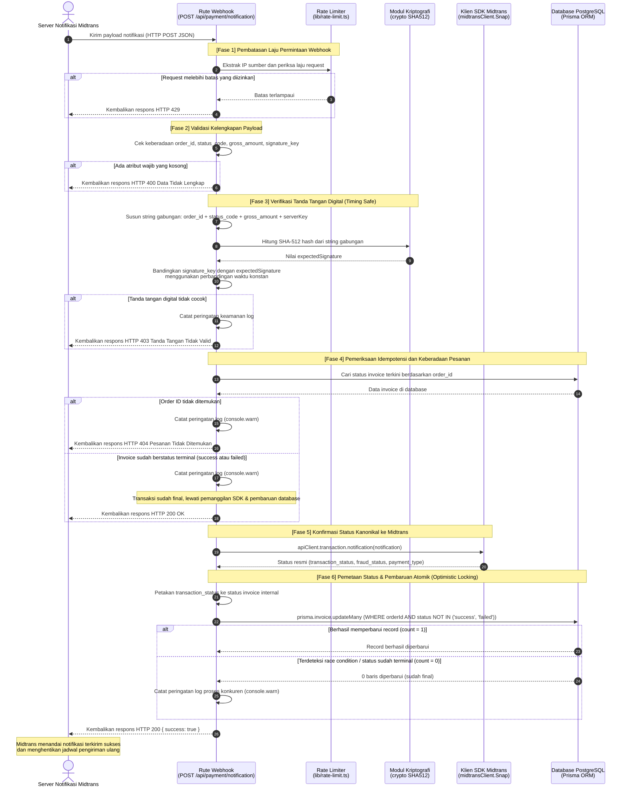

# Alur Notifikasi Webhook Midtrans dan Idempotensi

Dokumen ini menjelaskan alur penanganan notifikasi webhook asinkron dari gerbang pembayaran Midtrans ke endpoint `POST /api/payment/notification`. Alur ini bertanggung jawab memperbarui status pembayaran invoice secara akurat, memverifikasi keaslian pengirim menggunakan tanda tangan digital dengan perbandingan waktu konstan, serta mencegah pemrosesan transaksi berulang (idempotency).

[Kembali ke Indeks Arsitektur](README.md)

---

## Diagram Urutan Alur Notifikasi Webhook (Sequence Diagram)

Diagram berikut menggambarkan tahapan lengkap dari saat server Midtrans memicu notifikasi HTTP POST hingga database diperbarui dan tanda terima berhasil dikembalikan.

---

## Logika Pemetaan Status Pembayaran

Nilai `transaction_status` dan `fraud_status` yang dikembalikan oleh Midtrans dipetakan ke dalam status invoice internal dengan aturan sebagai berikut:

| Status Transaksi Midtrans | Status Fraud | Status Invoice Internal | Keterangan Bisnis |
|---|---|---|---|
| `capture` | `accept` | `success` | Transaksi kartu kredit berhasil disetujui tanpa kecurigaan fraud. |
| `capture` | `challenge` | `pending` | Transaksi terindikasi mencurigakan oleh sistem deteksi fraud Midtrans, menunggu peninjauan manual. |
| `settlement` | apa saja | `success` | Dana telah berhasil diselesaikan melalui metode QRIS, Virtual Account, atau E-Wallet. |
| `cancel` | apa saja | `failed` | Transaksi dibatalkan oleh pengguna atau merchant. |
| `deny` | apa saja | `failed` | Transaksi ditolak oleh bank penerbit atau gerbang pembayaran. |
| `expire` | apa saja | `failed` | Batas waktu pembayaran telah habis sebelum pengguna menyelesaikan pembayaran. |
| `pending` | apa saja | `pending` | Pengguna telah menerima nomor Virtual Account atau kode QRIS namun belum mentransfer dana. |

---

## Mekanisme Idempotensi dan Pencegahan Serangan

Alur webhook ini dirancang dengan beberapa pertahanan penting:

### 1. Verifikasi Signature Tahan Serangan Timing (Timing Safe Equal)
Verifikasi keaslian pesan dilakukan dengan membandingkan hash SHA-512 yang dihasilkan server dengan nilai `signature_key` dari Midtrans. Perbandingan string biasa rentan terhadap timing attack, yaitu teknik di mana penyerang mengukur selisih waktu eksekusi untuk menebak karakter string satu per satu. Sistem menggunakan perbandingan waktu konstan seperti `crypto.timingSafeEqual` pada buffer hash untuk memastikan durasi perbandingan identik terlepas dari titik ketidakcocokan karakter.

### 2. Perlindungan Idempotensi dan Pencegahan Race Condition (Two-Tier Guard)
Midtrans menerapkan kebijakan pengiriman ulang (retry policy) otomatis apabila server merchant lambat merespons atau mengembalikan kode galat HTTP selain 200. Skenario retry paralel dapat memicu kondisi pacu (race condition) jika dua notifikasi tiba bersamaan dalam hitungan milidetik saat invoice masih berstatus `pending`. Sistem menerapkan arsitektur dua lapis (two-tier guard):
- **Lapis 1 (Fast-Path Filter)**: Pemeriksaan awal status invoice di database via `findUnique`. Jika status sudah berstatus akhir (`success` atau `failed`), request langsung dihentikan dengan mengembalikan HTTP 200 tanpa memanggil Midtrans SDK atau melakukan penulisan database.
- **Lapis 2 (Atomic Conditional Update / Optimistic Locking)**: Pada saat pembaruan status, sistem menggunakan `prisma.invoice.updateMany` dengan filter bersyarat `status NOT IN ('success', 'failed')`. Di PostgreSQL, pembaruan bersyarat ini dieksekusi secara atomik menggunakan exclusive row-level lock. Jika request paralel lain telah memfinalisasi transaksi lebih dulu, kueri ini menghasilkan `count: 0`. Sistem mendeteksi `count === 0`, mencatat peringatan bahwa invoice telah diperbarui oleh proses konkuren, dan tetap mengembalikan HTTP 200 agar Midtrans menghentikan percobaan ulang. Pola ini juga menjamin webhook yang datang terlambat (*delayed/out-of-order*) tidak dapat menimpa status transaksi yang sudah berhasil diselesaikan kembali ke status `pending`.

### 3. Konfirmasi Status Melalui SDK Resmi
Sistem tidak hanya membaca isi JSON mentah yang dikirim oleh pengirim, tetapi juga memanggil fungsi `apiClient.transaction.notification(notification)` dari pustaka resmi Midtrans. Langkah ini memastikan data transaksi yang diproses adalah data kanonikal yang valid menurut catatan inti Midtrans.

### 4. Respons Status HTTP yang Tepat
Setiap kondisi kegagalan menghasilkan kode status HTTP yang sesuai:
- `400 Bad Request`: Payload JSON tidak memiliki atribut wajib yang diperlukan.
- `403 Forbidden`: Tanda tangan digital tidak cocok dengan server key resmi.
- `429 Too Many Requests`: Frekuensi panggilan melebihi ambang batas keamanan.
- `200 OK`: Notifikasi berhasil diproses, diabaikan karena status sudah final, atau ditangani secara aman saat terjadi race condition konkuren.
